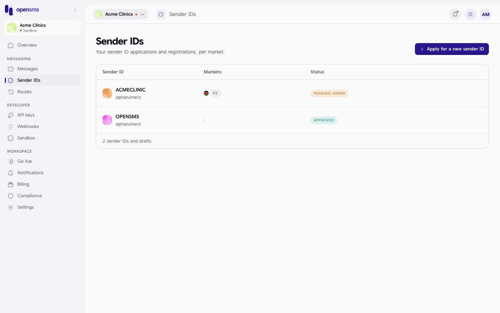
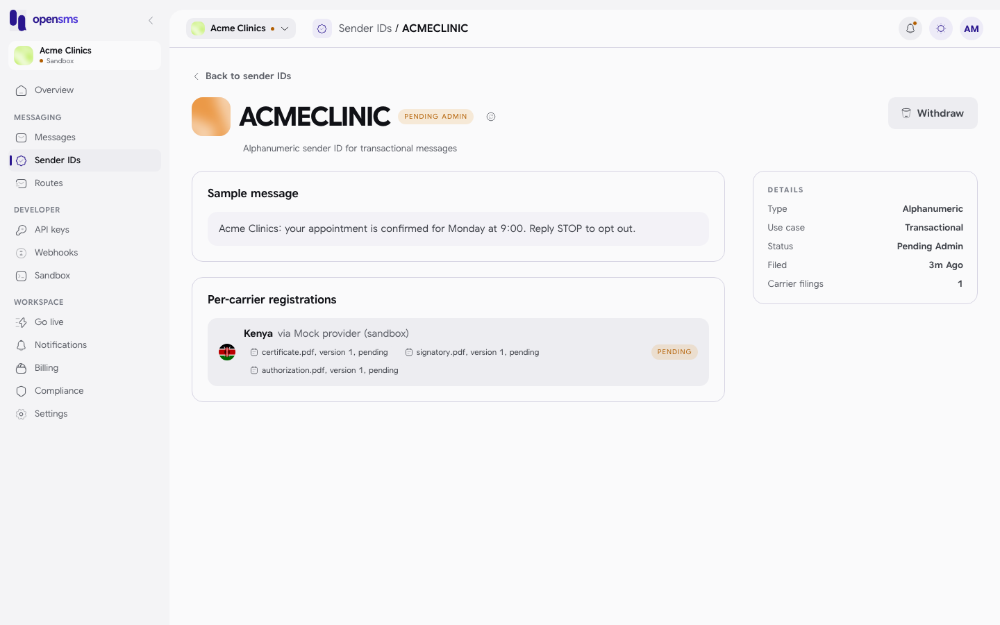
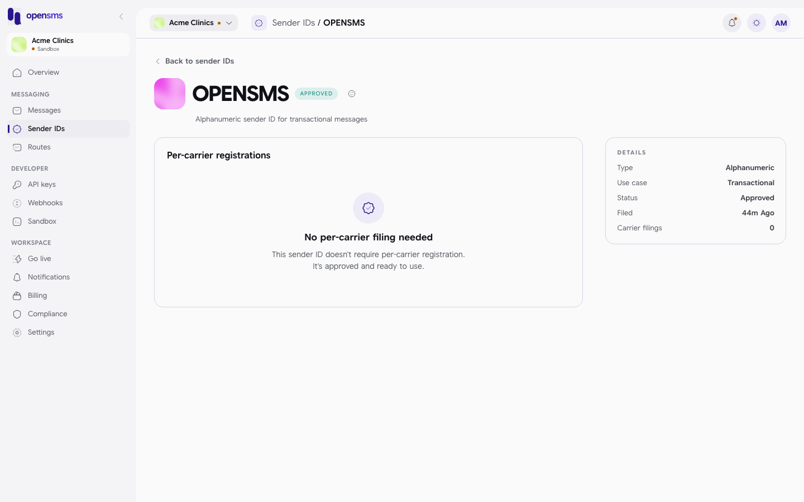
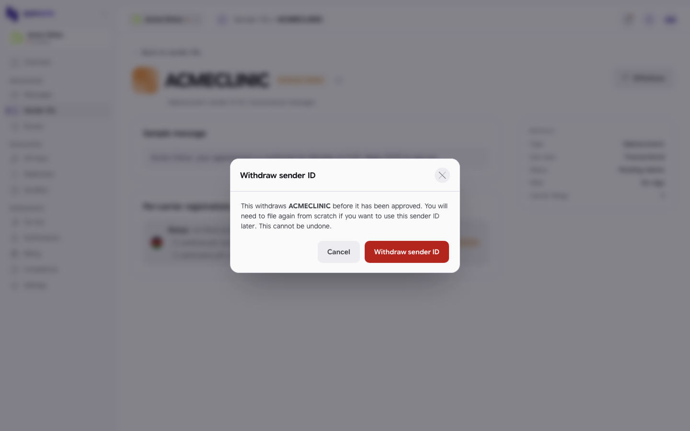

# Sender IDs

A sender ID is the name your recipients see as the sender of your text, such as `ACMECLINIC`, instead of a phone number. Carriers only let you use a name after it has been checked and registered, so OpenSMS walks you through an application and then tracks it market by market. This guide is for workspace owners and admins who apply for sender IDs, and for anyone who wants to check where an application stands.

Open **Sender IDs** in the left-hand menu (`/app/sender-ids`).

## Who can do what

| Action | Owner | Admin | Developer | Finance | Viewer |
| --- | --- | --- | --- | --- | --- |
| See sender IDs and their status | Yes | Yes | Yes | Yes | Yes |
| Apply, save drafts, upload documents, withdraw, resubmit | Yes | Yes | No | No | No |

Members who cannot apply can still open the pages; the buttons are greyed out with the reason.

## The sender ID list

Each row shows the name and its type (alphanumeric), the markets it is registered or requested in (as country codes), and its status. A draft row has a **Continue application** link. Click a row to open its [detail page](#check-an-application).

Every workspace also sees **OPENSMS**, the platform's shared sender, already **Approved**. You can send with it straight away (in sandbox) while your own name is being reviewed.

### Registration workflow

The list and detail page show the current registration stage and next step. Payment, OpenSMS review, and carrier registration are separate facts. **Paid does not mean active.**

| Stage | What happens next |
| --- | --- |
| Application draft | Complete the application and submit it for review. |
| OpenSMS review | Wait while the application and current evidence are reviewed. |
| Payment needed | Open and pay the accepted package invoice from the live wallet. |
| Paid, under OpenSMS review | Payment is recorded; OpenSMS checks the filing prerequisites. Do not pay again. |
| Carrier filing queued | OpenSMS prepares the filing. A queued internal task does not mean the carrier has received it. |
| Filing with carrier | Submission has started. Wait for confirmation. |
| Awaiting carrier decision | The filing is submitted and awaiting the carrier's decision. |
| Carrier filing needs review | The submission outcome is uncertain. Contact support; do not submit or pay again. |
| Active | The sender is ready on its approved networks, subject to the workspace's live sending requirements. |
| Changes requested | Read the reason. Before registration acceptance, update the application where offered. An accepted filing that needs correction requires support review. |
| Registration on hold | A current prerequisite needs attention. Follow the displayed instruction or contact support. |
| Registration rejected | Read the decision. Contact support about the next step and any eligible finance review. |
| Refunded or Cancelled | This package is no longer continuing. A refund returns the recorded full payment to the live wallet. |
| Suspended or Authorization review | Sending is paused while the restriction or authorization is reviewed. |

The progress panel shows the invoice, registration milestones, selected networks and blockers. A Kenya package is reviewed as a bundle. Its network rows show the shared package decision, not independently recorded approvals. Activation waits for confirmation on all selected networks.

## Apply for a sender ID

Owners and admins use **Apply for a new sender ID** at `/app/sender-ids/new`. The current business application has five stages: sender details, business, evidence, review and status. **Save for later** keeps an editable draft. Submitting the application starts review only. It does not register with a carrier, create a charge or debit your wallet.

1. **Sender details:** enter an alphanumeric name of up to 11 characters, select the countries where you want to use it, choose the message purpose and add a sample message. OpenSMS checks whether the name can be requested in each selected market. Protected names may require extra authorization. Market selection is explicit. A country suggested during signup from your IP address or browser locale can be changed, and it never changes an existing workspace's country.
2. **Your business:** choose a registered business profile and an authorized signatory. You can reuse saved business details and see the exact revisions attached to this sender application.
3. **Markets and evidence:** choose an available registration option for each market and attach the required incorporation, address, signatory identity and authorization evidence. The authorization letter must cover this sender, business, signatory, routes and valid dates. Documents are scanned and reviewed.
4. **Review:** check the exact name, business, routes, message and evidence versions, confirm the authorization scope, then select **Submit application for review**. The application may wait for business verification or receive a request for changes.
5. **Status:** check the review result and revision history. Registration choices appear only after the current application, business profile and all required evidence have been approved.

### Choose a Kenya registration package

Once the application is **Approved for registration**, choose the networks. These are one-time guide prices in Kenya shillings, with **no VAT charged**:

| Networks | Guide price |
| --- | ---: |
| Safaricom | KES 7,500 |
| Airtel | KES 7,500 |
| Telkom | KES 5,000 |
| Safaricom + Airtel | KES 13,500 |
| All three networks | KES 18,500 |

The server returns the current quote and availability for the selected package. A package can be unavailable even when its guide price is shown, including while OpenSMS issuer details are not configured. Review the current total and accept that exact quote. If the quote or availability changes, refresh it before accepting. **Create registration invoice** records the accepted package and issues an invoice with the issuer details in effect at acceptance, but takes no wallet payment yet. You can download the invoice PDF immediately. Carrier submission waits for payment and the remaining reviews.

Open the invoice from the confirmation link or **Billing > Invoices**. Select **Pay from live wallet** to pay the one-time amount. If your live balance is too low, the payment returns `402`: fund the live wallet, wait until the credit is confirmed, then select **Pay from live wallet** again. Payment is recorded once for the invoice; carrier submission does not charge you a second time.

You can cancel the registration invoice before external submission starts, including while a manual filing is only queued. If it was paid, the full amount returns to the same live wallet; if unpaid, no payment is taken. Once an external call has started, including an uncertain outcome, ordinary cancellation is unavailable until the filing is resolved. After carrier submission, there is no automatic refund. Contact support if a finance exception is needed.

### Pricing and PDF guides

The public [pricing page](https://opensms.io/pricing/#sender-ids) has generic PDF downloads. The same four documents are available at `/v1/public/documents/{ID}/download` with IDs `sender-id-pricing`, `sms-pricing`, `message-types-guide` and `sender-ids-outside-kenya`. Public copies contain no private business name.

Owners and admins can obtain versions prepared for the verified legal name from `/v1/business-profiles/{profile_id}/kenya-documents` and its document download links. Access requires the current Kenya business identity and all required evidence to be approved. These documents are guides and quotes, not registration approval.

## Check an application

Open a sender ID from the list (`/app/sender-ids/<id>`).

The page shows:

- the name, its current workflow stage, and a refresh button to reload the status;
- **Sample message** you filed;
- **Registration progress**: the status of the selected package's carrier filing, with filing and review times when available. The accepted package price, selected networks and payment status are on the invoice in Billing. Document chips show the file name, version and review state (`pending`, `approved` or `rejected`, with the reason when rejected);
- **Details**: type, use case, status, when it was filed and how many carrier filings there are.

An approved name that needs no carrier filing (like the shared `OPENSMS`) says **No per-carrier filing needed**:

## Withdraw an application

While a sender ID is a draft, pending, or rejected, owners and admins see **Withdraw**.

1. Click **Withdraw**.
2. Read the warning: you would need to file again from scratch to use the name later, and it cannot be undone.
3. Click **Withdraw sender ID**. You see "Sender ID withdrawn." and return to the list.

An approved or suspended sender ID cannot be withdrawn from here.

## If an application is rejected

When the OpenSMS team rejects an application, the page shows:

- A red banner at the top shows the rejection reason, with **Amend and resubmit**.
- A rejected market row shows its reason and a **Resubmit** button.
- Either button opens **Resubmit filing**: read the reason, edit the **Sample message**, optionally replace any of the three documents, then click **Resubmit for review**. Your existing documents are kept unless you replace them. You see "Sender ID resubmitted for review."

A rejected **document** (its chip says `rejected` with a reason) is replaced the same way, through **Resubmit**.

## Related

- [Onboarding](onboarding.md) (where your first sender ID draft is started)
- [Messages](messages.md) (using an approved sender ID)
- [Routes](routes.md) (which markets you can actually reach)
- [Billing](billing.md) (paying the registration invoice from the live wallet)
